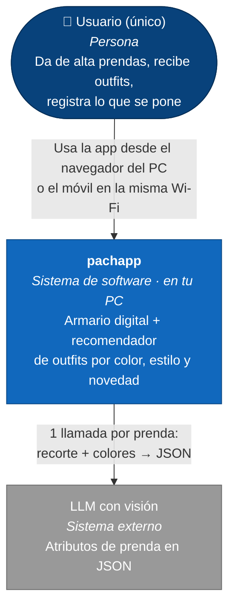
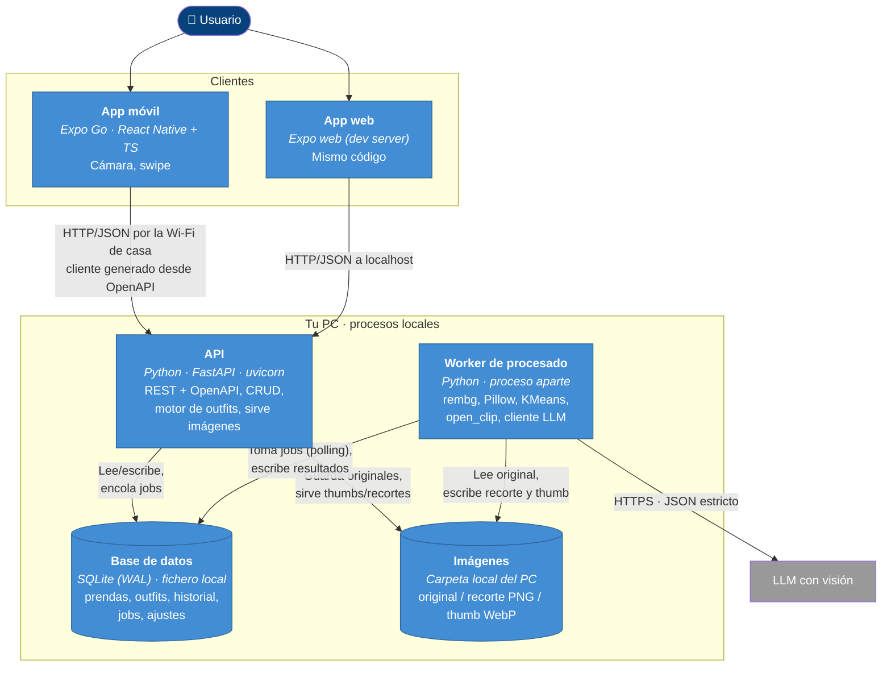
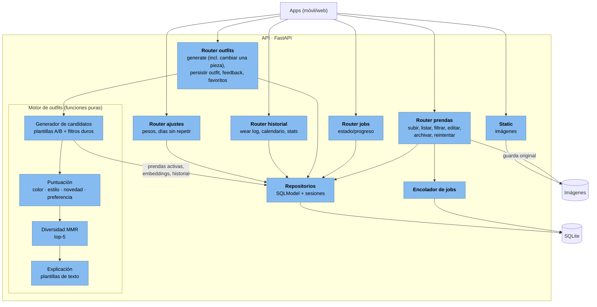
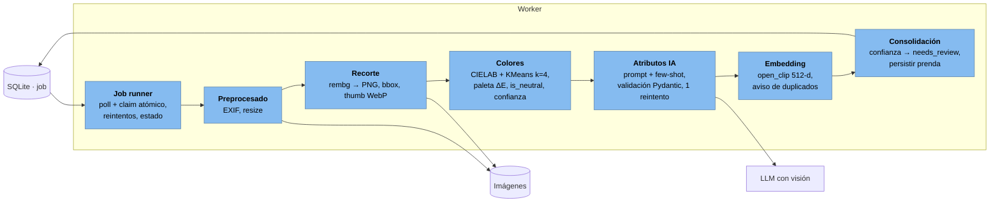
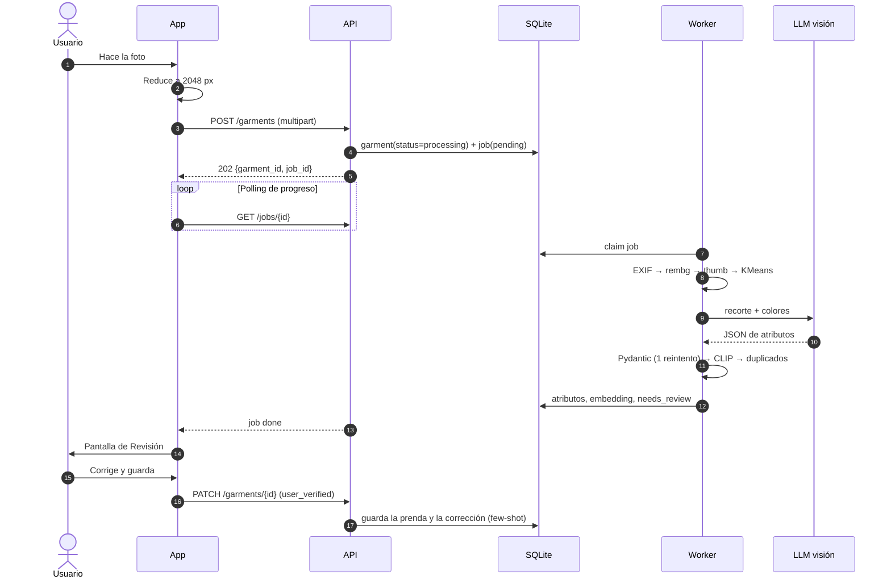
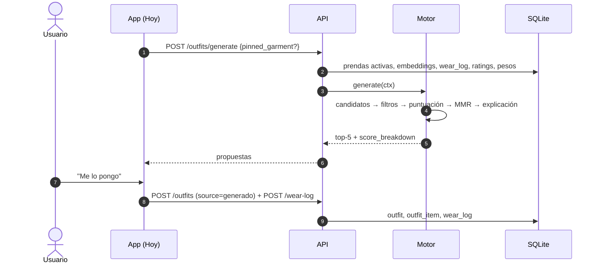

# Arquitectura C4 — Armario inteligente (pachapp)

Fuente: `spec-armario-inteligente(1).md` (borrador del 27-09-2026).

**Alcance: iteración 1, casi todo en local.** Todo corre en tu PC como procesos normales, sin Docker ni servidor. Las imágenes y la base de datos viven en el disco del PC. No hay autenticación, ni copias de seguridad, ni acceso remoto. La única dependencia externa es el LLM con visión. Lo que se deja fuera está en [Aplazado](#aplazado-fuera-de-la-iteración-1).

Notación: los diagramas usan `flowchart` de Mermaid con la semántica de C4 (persona, sistema, contenedor, componente) porque la sintaxis `C4Context` de Mermaid se renderiza de forma poco fiable.

---

## Nivel 1 — Contexto del sistema

**Límite de confianza:** lo único que sale del PC es el recorte de cada prenda y sus colores, que viajan una vez al LLM. La API no tiene login, así que debe escuchar solo en `localhost` o en la red de casa, nunca con un puerto abierto a internet.

---

## Nivel 2 — Contenedores

| Contenedor | Tecnología | Responsabilidad | Notas |
| --- | --- | --- | --- |
| App móvil | Expo Go, Expo Router, TanStack Query, expo-image, reanimated | Toda la UI; cámara y reducción de la foto a 2048 px antes de subirla | Llega a la API por la IP del PC en la LAN (requiere D13). Todas las librerías funcionan en Expo Go sin build propia |
| App web | Servidor de desarrollo de Expo (`react-native-web`) | La misma UI en el navegador | El swipe en web es parcial; los botones son la vía principal |
| API | FastAPI, SQLModel, Alembic, numpy | CRUD, generación de outfits (síncrona, menos de 1 s), feedback, archivos estáticos | Sin auth. Puerto 8000, en la LAN. CORS para la web (D15) |
| Worker | Python, rembg, open_clip, scikit-learn, Pillow | Pipeline de alta de prendas (pasos 2–7 del spec) | Carga los modelos una vez. RAM estimada 1,5–2,5 GB, sin medir |
| SQLite | Fichero en modo WAL, en el ext4 de WSL2 | Fuente de verdad, incluida la cola `job` | API y worker escriben a la vez (ver D4). Nunca en `/mnt/d` (ver D14) |
| Imágenes | Carpeta en el ext4 de WSL2 (configurable) | Ficheros binarios; la BD guarda rutas relativas | Sin copia de seguridad en la iteración 1 |

---

## Nivel 3 — Componentes de la API

## Nivel 3 — Componentes del worker

---

## Dinámico — Alta de una prenda

## Dinámico — Outfit del día

---

## Decisiones de arquitectura (iteración 1)

Estado: **aprobadas** (27-09-2026). Las validó un revisor independiente contra el spec y contra fuentes primarias.

| ID | Decisión | Motivo (evidencia) |
| --- | --- | --- |
| D0 | **Ejecución local sin contenedores:** `uvicorn` para la API, `python -m worker` para el worker y el servidor de desarrollo de Expo, todo lanzado desde el `Makefile` (D16). Rutas de la BD y de las imágenes en un `.env`. | Alcance de la iteración 1: nada de infraestructura. |
| D1 | **Motor en dos etapas.** 1) Generar y puntuar solo la base (A: top+bottom+shoes, B: one_piece+shoes), con los filtros duros aplicados por bloques en numpy. 2) Tomar las K mejores bases (K≈300), ampliar cada una con las mejores opciones de outerwear/accessory (o ninguna) y volver a puntuar el outfit completo antes del MMR. | Con 300 prendas, el producto completo pasa de ~112 M combinaciones. Los filtros duros solo recortan del orden de 5–10×. |
| D4 | **Concurrencia en SQLite:** WAL, `busy_timeout` ≈5 s, transacciones cortas y reclamación atómica del job (`UPDATE … WHERE status='pending' RETURNING`). El worker no mantiene transacciones abiertas mientras procesa. | API y worker escriben en las mismas tablas. |
| D5 | **Tablas añadidas al modelo:** `job`, `setting` y `ai_correction`. | El spec las usa pero no las define. |
| D6 | **Persistir solo los outfits con interacción** (dislike, favorito, "me lo pongo"). | Los dislikes deben restar en el futuro sin llenar la BD de ruido. |
| D7 | `wear_log` con `UNIQUE(date)`. Los campos derivados se actualizan en la misma transacción. | El spec dice "uno por día" sin restricción. |
| D8 | ~~Filtro de temporada actual.~~ **Descartado en la iteración 1:** sin filtros ni puntuación por temporada. El campo `seasons` se sigue extrayendo y guardando para usarlo más adelante. | Decisión del usuario (27-09-2026). |
| D9 | **Duplicados:** umbral de CLIP calibrado (orientativo 0,90–0,95), solo como aviso. | CLIP da similitudes ≥0,95 entre imágenes distintas (arXiv 2411.05195). |
| D10 | **Confianza del color** derivada de KMeans. Si es baja, activa `needs_review`. | Hoy los colores nunca pueden activar la revisión. |
| D11 | **Versión del LLM fijada** + test de contrato del JSON. | Evita roturas silenciosas. |
| D12 | **El try-on pasa a llamarse "v2".** | El nombre "Fase 2" se usaba para dos cosas distintas. |
| D16 | **Herramientas de desarrollo.** Python gestionado con `uv` (`pyproject.toml` + `uv.lock`). Pydantic v2 para todos los contratos: esquemas de la API, salida del LLM y ajustes (`pydantic-settings`). Un `Makefile` en la raíz como punto de entrada único (`make install`, `make run`, `make run-worker`, `make run-ui`, `make test`, `make lint`, `make fmt`, `make migrate`, `make gen-client`). | Decisión del usuario: calidad de código y un solo punto de entrada. |
| D17 | **Capas en la v1.** Nueva categoría `mid_layer` (jersey, sudadera, cárdigan, sobrecamisa) entre `top` y `outerwear`. Un outfit tiene como máximo 1 `mid_layer`, 1 `outerwear` y hasta N `accessory` (N=2 por defecto, configurable; nunca dos del mismo subtipo). `outfit_item` añade `layer` para el orden de apilado. El motor añade las capas en la etapa 2 de D1. | Decisión del usuario: capas en la v1 (jersey, abrigo, complementos). |
| D18 | **Reglas de color básicas.** Los neutros combinan con todo. Máximo 2 colores no neutros entre las prendas de ropa; los complementos no cuentan. Entre dos no neutros se puntúa por tono con solo tres niveles: análogos (≤30°) alto, complementarios (150–210°) medio y el resto bajo. Se mantiene la penalización por dos estampados llamativos juntos. Sin bonus de tono sobre tono ni triadas, y el máximo de colores no es configurable. | Decisión del usuario: reglas básicas por ahora. |
| D19 | **Revisión con un único botón.** Corregir un campo guarda la corrección (`ai_correction`), pero no quita `needs_review`. Solo el botón "Revisión terminada" pone `needs_review=false` y `user_verified=true`. | Decisión del usuario. |
| D13 | **Red en WSL2:** modo `networkingMode=mirrored` en `.wslconfig` (Windows 11 22H2+) más reglas del firewall de Hyper-V para los puertos de la API y de Metro. Plan B: `netsh interface portproxy` + regla del firewall de Windows. `expo start --tunnel` solo como último recurso, porque añade una dependencia externa. | En el modo NAT por defecto, el móvil en la LAN no llega a los servicios de WSL2 (learn.microsoft.com/windows/wsl/networking). |
| D14 | **Datos en el ext4 de WSL2** (p. ej. `~/pachapp-data/{db,images}`), no en `/mnt/d`. Desde Windows se accede con `\\wsl.localhost\…`. El código sí puede vivir en `/mnt/d`. | El modo WAL de SQLite necesita memoria compartida y un bloqueo fiable (sqlite.org/wal.html), y `/mnt/*` va por 9P. La E/S de imágenes en `/mnt/d` también es más lenta. |
| D15 | **CORS en FastAPI** (`CORSMiddleware`) con orígenes permitidos: el servidor web de Expo (`localhost:8081`) y la IP de la LAN. Puertos de referencia: API 8000, Metro/web 8081. | La web de Expo y la API usan puertos distintos, así que son orígenes distintos. |

## Aplazado (fuera de la iteración 1)

Diseño ya validado, listo para cuando se retome:

- **Infraestructura:** Docker Compose, VPS o servidor en casa, acceso remoto con Tailscale, builds con EAS.
- **Autenticación (antes D3):** cookie `HttpOnly` en web y SecureStore en nativo. `expo-secure-store` no soporta web (docs.expo.dev/versions/latest/sdk/securestore).
- **Copias de seguridad (antes D2):** Litestream para SQLite y `rclone` para las imágenes, ambos hacia R2. Litestream solo replica SQLite (litestream.io/how-it-works).
- **Caché offline y exportación ZIP.**
- **Try-on (v2)**, incluida la tabla `user_photo` (fotos de cuerpo entero del usuario), que no se crea en la iteración 1.

Para retomarlo sin rehacer nada, la iteración 1 ya deja preparado:

- rutas de imagen **relativas** a una raíz configurable, para poder mover las imágenes a R2 sin migrar datos;
- una API **sin estado de sesión**, para poder añadir la auth como una dependencia más de FastAPI.
