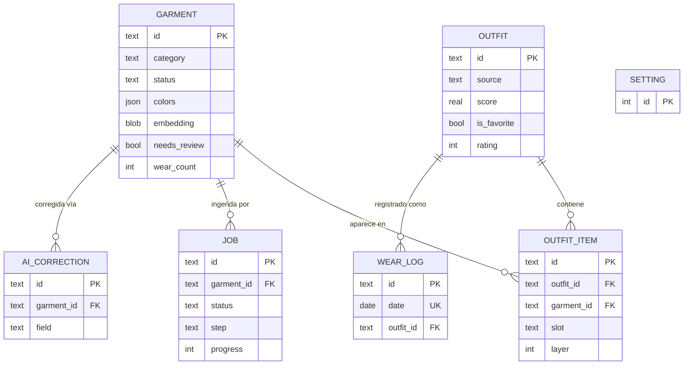

# 02 — Modelo de datos

Estado: Draft

## Alcance

Todas las tablas, columnas, tipos, nulabilidad, restricciones, índices, enums, esquemas de campos JSON, relaciones, reglas de mantenimiento de campos derivados y política de migraciones para la iteración 1: `garment`, `outfit`, `outfit_item`, `wear_log`, `job`, `setting`, `ai_correction`.

## Fuera de alcance

`user_photo` (tabla del try-on/v2) — esquema documentado en "Fuera de alcance / próximas iteraciones" más abajo, no creada en la iteración 1. Cualquier tabla necesaria solo para auth, backups o exportación.

## Dependencias

- Decisiones: D1 (capas referenciadas por `outfit_item.layer`), D4 (forma de la reclamación del job), D5 (tablas añadidas), D6 (política de persistencia), D7 (unicidad de `wear_log`), D9 (almacenamiento del umbral de duplicados), D10 (confianza del color), D11 (id de modelo fijado), D16 (SQLModel + Pydantic v2 + Alembic), D17 (capas/`mid_layer`), D18 (reglas de color: sin columnas de configuración para el máximo), D19 (revisión con un único botón: DAT-REQ-018/019). D8 fue descartado (sin lógica de temporada) — ver "Cambios de decisión" más abajo.
- Consumido por: 03-garment-ingestion.md, 04-wardrobe-api.md, 05-outfit-engine.md, 06-feedback-history.md.

## Convenciones

- Todas las claves primarias son UUIDv4 almacenadas como `TEXT` (SQLite no tiene tipo UUID nativo), salvo que se indique lo contrario.
- Todos los timestamps son `DATETIME` en UTC (texto ISO 8601), escritos por la capa de aplicación.
- Las columnas JSON se almacenan como `TEXT` de SQLite y se validan en el borde de la aplicación con modelos Pydantic v2 (D16) — SQLite no impone un tipo JSON nativo, así que **todas** las lecturas/escrituras de estas columnas DEBEN pasar por el esquema Pydantic, nunca acceso directo a dict.

## Enums

```python
class GarmentCategory(str, Enum):
    top = "top"
    bottom = "bottom"
    one_piece = "one_piece"
    mid_layer = "mid_layer"      # D17: jersey, sudadera, cárdigan, sobrecamisa
    outerwear = "outerwear"
    shoes = "shoes"
    accessory = "accessory"

class GarmentPattern(str, Enum):
    solid = "solid"
    striped = "striped"
    plaid = "plaid"
    printed = "printed"
    textured = "textured"

class GarmentStatus(str, Enum):
    active = "active"
    laundry = "laundry"
    archived = "archived"

class Season(str, Enum):
    spring = "spring"
    summer = "summer"
    autumn = "autumn"
    winter = "winter"

class StyleTag(str, Enum):
    casual = "casual"
    classic = "classic"
    street = "street"
    minimal = "minimal"
    sport = "sport"
    elegant = "elegant"
    bohemian = "bohemian"
    preppy = "preppy"

class OutfitSlot(str, Enum):
    top = "top"
    bottom = "bottom"
    one_piece = "one_piece"
    mid_layer = "mid_layer"
    outerwear = "outerwear"
    shoes = "shoes"
    accessory = "accessory"

class OutfitSource(str, Enum):
    generated = "generated"
    manual = "manual"

class JobStatus(str, Enum):
    pending = "pending"
    claimed = "claimed"
    running = "running"
    done = "done"
    failed = "failed"

class JobStep(str, Enum):
    preprocess = "preprocess"
    cutout = "cutout"
    color = "color"
    ai_attributes = "ai_attributes"
    embedding = "embedding"
    consolidate = "consolidate"
```

**DAT-REQ-001.** `GarmentCategory`, `GarmentPattern`, `GarmentStatus`, `Season`, `StyleTag`, `OutfitSlot`, `OutfitSource`, `JobStatus`, `JobStep` DEBEN ser `Enum` cerrados de Python, reutilizados de forma idéntica en `pachapp_shared` (BD), los esquemas de la API y el contrato del LLM (03-garment-ingestion.md) — una sola definición, importada en todas partes, nunca redefinida por capa.

## `garment`

| Columna | Tipo | Nulable | Notas |
| --- | --- | --- | --- |
| `id` | TEXT (UUID) | No | PK |
| `created_at` | DATETIME | No | |
| `updated_at` | DATETIME | No | Se actualiza en cada escritura |
| `img_original` | TEXT | No | Ruta relativa bajo `PACHAPP_IMAGES_ROOT` |
| `img_cutout` | TEXT | Sí | Null hasta que el paso `cutout` del worker termine |
| `img_thumb` | TEXT | Sí | Null hasta que `cutout` termine |
| `category` | TEXT (enum) | Sí | Null hasta el paso de atributos IA o entrada manual |
| `subcategory` | TEXT | Sí | Texto libre; para la categoría `accessory` también actúa como el *subtipo* que usa la regla del motor de "no dos del mismo subtipo" (05-outfit-engine.md) |
| `colors` | JSON | Sí | Ver esquema abajo; null hasta el paso `color` |
| `is_neutral` | BOOLEAN | Sí | Derivado de `colors[0].name` contra la lista de neutros (negro, blanco, gris, beige, camel, marino, denim) |
| `pattern` | TEXT (enum) | Sí | |
| `formality` | INTEGER | Sí | 1–5 |
| `style_tags` | JSON (list[str]) | Sí | Subconjunto de `StyleTag` |
| `seasons` | JSON (list[str]) | Sí | Subconjunto de `Season`, no vacío cuando está fijado |
| `warmth` | INTEGER | Sí | 1–5 |
| `material` | TEXT | Sí | Texto libre |
| `brand` | TEXT | Sí | Texto libre |
| `notes` | TEXT | Sí | Texto libre |
| `status` | TEXT (enum) | No | Por defecto `active` |
| `embedding` | BLOB | Sí | Vector CLIP de 512 × float32, null hasta el paso `embedding` |
| `ai_confidence` | JSON | Sí | `{nombre_campo: float 0..1}`, una entrada por campo poblado por IA |
| `color_confidence` | REAL | Sí | 0..1, derivado de la separación de clústeres de KMeans (D10) |
| `needs_review` | BOOLEAN | No | Por defecto `false`; ver regla abajo |
| `user_verified` | BOOLEAN | No | Por defecto `false` |
| `wear_count` | INTEGER | No | Por defecto `0`, derivado |
| `last_worn_at` | DATE | Sí | Derivado |

Índices: `idx_garment_status`, `idx_garment_category`, `idx_garment_needs_review`.

**DAT-REQ-002.** `needs_review` DEBE fijarse a `true` por el paso `consolidate` del worker cuando: algún valor de `ai_confidence` sea `< settings.needs_review_threshold` (por defecto `0.7`), O `color_confidence < settings.color_review_threshold` (por defecto `0.7`) — combinando la regla de confianza IA del borrador con la adición de D10 de la confianza del color como disparador independiente.

**DAT-REQ-003.** `wear_count` y `last_worn_at` SOLO DEBEN escribirse desde la transacción de mantenimiento de `wear_log` (ver abajo) — nunca directamente desde los endpoints de edición de prendas.

### Esquema JSON de `colors`

```python
class ColorEntry(BaseModel):
    name: str              # nombre de paleta más cercano, p. ej. "marino"
    hex: str                # "#1a2b4c"
    lab: tuple[float, float, float]
    proportion: float       # 0..1, suma <=1 entre entradas

class Colors(RootModel[list[ColorEntry]]):
    ...  # la primera entrada = color dominante; ordenado por proporción desc
```

### Esquema JSON de `ai_confidence`

`dict[str, float]` — las claves son un subconjunto de `{"category", "subcategory", "pattern", "formality", "style_tags", "seasons", "warmth", "material"}`, valores en `[0, 1]`.

## `outfit`

| Columna | Tipo | Nulable | Notas |
| --- | --- | --- | --- |
| `id` | TEXT (UUID) | No | PK |
| `created_at` | DATETIME | No | |
| `source` | TEXT (enum) | No | `generated` \| `manual` |
| `score` | REAL | Sí | Null para outfits `manual` salvo que se puntúen a posteriori |
| `score_breakdown` | JSON | Sí | Ver esquema abajo |
| `is_favorite` | BOOLEAN | No | Por defecto `false` |
| `rating` | INTEGER | No | Por defecto `0`; uno de `{-1, 0, 1}` |
| `name` | TEXT | Sí | Etiqueta editable por el usuario |
| `explanation` | TEXT | Sí | Frase en español generada por plantilla, fijada en el momento de la creación |

**DAT-REQ-004.** Según D6, una fila en `outfit` (y sus `outfit_item`) SOLO DEBE crearse cuando el usuario realiza una interacción calificante (no me gusta, favorito, o "me lo pongo") sobre una propuesta generada — nunca en el momento de la generación. Ver o descartar ("siguiente") una propuesta NO DEBE crear ninguna fila. Ver 06-feedback-history.md para el mapeo completo interacción→persistencia.

**DAT-REQ-005.** `rating` DEBE restringirse a `{-1, 0, 1}` en la capa de aplicación (restricción `CHECK` de SQLModel o validador Pydantic).

### Esquema JSON de `score_breakdown`

```python
class ScoreBreakdown(BaseModel):
    color: float
    style: float
    novelty: float
    preference: float
    total: float
```

## `outfit_item`

| Columna | Tipo | Nulable | Notas |
| --- | --- | --- | --- |
| `id` | TEXT (UUID) | No | PK |
| `outfit_id` | TEXT (UUID) | No | FK → `outfit.id` |
| `garment_id` | TEXT (UUID) | No | FK → `garment.id` |
| `slot` | TEXT (enum) | No | `OutfitSlot` |
| `layer` | INTEGER | Sí | Orden de apilado para el renderizado; ver convención abajo |

Índices: `idx_outfit_item_outfit`, `idx_outfit_item_garment`. Restricción única: `(outfit_id, garment_id)` — una prenda aparece como máximo una vez por outfit.

**DAT-REQ-006.** `layer` DEBE codificar el orden de apilado vertical para el renderizado en la UI (07-app-ui.md), donde el valor más alto = visualmente más exterior/superior: `outerwear=4`, `mid_layer=3`, `top=2`, `one_piece=2`, `bottom=1`, `shoes=0`. Las filas `accessory` DEBEN tener `layer = NULL` (los complementos no forman parte de la pila vertical; la UI los renderiza como una fila separada). *(valor por defecto, ajustable)*

## `wear_log`

| Columna | Tipo | Nulable | Notas |
| --- | --- | --- | --- |
| `id` | TEXT (UUID) | No | PK |
| `date` | DATE | No | `UNIQUE` (D7) |
| `outfit_id` | TEXT (UUID) | No | FK → `outfit.id` |
| `created_at` | DATETIME | No | |

**DAT-REQ-007.** `date` DEBE ser `UNIQUE` (D7) — como máximo un outfit registrado por día natural.

**DAT-REQ-008.** Insertar, actualizar (sobrescribir) o borrar una fila de `wear_log` DEBE recalcular `wear_count` y `last_worn_at` para cada prenda referenciada por el/los outfit(s) afectado(s), en la **misma transacción** que la escritura de `wear_log` (D7). `wear_count` = recuento de filas distintas de `wear_log` cuyo outfit contiene la prenda; `last_worn_at` = fecha máxima de `wear_log.date` entre esas.

## `job`

| Columna | Tipo | Nulable | Notas |
| --- | --- | --- | --- |
| `id` | TEXT (UUID) | No | PK |
| `garment_id` | TEXT (UUID) | No | FK → `garment.id` |
| `status` | TEXT (enum) | No | `JobStatus`, por defecto `pending` |
| `step` | TEXT (enum) | Sí | `JobStep`, paso actual/último completado |
| `progress` | INTEGER | No | 0–100, por defecto `0` |
| `attempts` | INTEGER | No | Por defecto `0` |
| `error` | TEXT | Sí | Mensaje de error legible |
| `result` | JSON | Sí | Metadatos no-error: p. ej. información del candidato a duplicado (ver 03-garment-ingestion.md) |
| `claimed_by` | TEXT | Sí | Identificador del proceso worker (pid/hostname), para la reclamación atómica (D4) |
| `claimed_at` | DATETIME | Sí | |
| `started_at` | DATETIME | Sí | |
| `finished_at` | DATETIME | Sí | |
| `created_at` | DATETIME | No | |

Índice: `idx_job_status` (el worker hace polling con `WHERE status = 'pending'`).

**DAT-REQ-009.** Reclamar un job DEBE usar una única sentencia atómica: `UPDATE job SET status='claimed', claimed_by=?, claimed_at=? WHERE id = (SELECT id FROM job WHERE status='pending' ORDER BY created_at LIMIT 1) AND status='pending' RETURNING *` (D4) — sin ventana de carrera de lectura-y-luego-escritura.

**DAT-REQ-010.** El worker NO DEBE mantener una transacción SQLite abierta mientras llama al LLM o ejecuta pasos intensivos en CPU (rembg/KMeans/CLIP); cada escritura a BD es su propia transacción corta (D4).

## `setting`

Fila singleton (`id = 1`), creada por una migración de datos de Alembic que siembra los valores por defecto en el primer `make migrate`.

| Columna | Tipo | Nulable | Notas |
| --- | --- | --- | --- |
| `id` | INTEGER | No | PK, siempre `1` |
| `weight_color` | REAL | No | Por defecto `0.35` |
| `weight_style` | REAL | No | Por defecto `0.25` |
| `weight_novelty` | REAL | No | Por defecto `0.25` |
| `weight_preference` | REAL | No | Por defecto `0.15` |
| `no_repeat_days` | INTEGER | No | Por defecto `14` |
| `max_accessories` | INTEGER | No | Por defecto `2` (D17) |
| `duplicate_warning_threshold` | REAL | No | Por defecto `0.92`, rango calibrado `0.90–0.95` (D9) |
| `needs_review_threshold` | REAL | No | Por defecto `0.7` |
| `color_review_threshold` | REAL | No | Por defecto `0.7` |
| `updated_at` | DATETIME | No | |

*(Columnas retiradas: `max_non_neutral_colors` y `hemisphere` existieron en una revisión anterior de esta spec y se eliminan aquí — D18 fija el máximo de colores no neutros en 2, no configurable, y D8 elimina toda lógica de temporada, incluido el mapeo por hemisferio. Ver "Cambios de decisión" al final de este documento.)*

**DAT-REQ-011.** Las cuatro columnas `weight_*` DEBEN sumar `1.0 ± 0.01`; se valida en el endpoint PATCH de settings (04-wardrobe-api.md), no mediante una restricción de BD (SQLite carece de garantías portables de `CHECK` con aritmética entre columnas en la práctica).

## `ai_correction`

| Columna | Tipo | Nulable | Notas |
| --- | --- | --- | --- |
| `id` | TEXT (UUID) | No | PK |
| `garment_id` | TEXT (UUID) | No | FK → `garment.id` |
| `field` | TEXT | No | Nombre de columna de garment, p. ej. `"category"`, `"formality"` |
| `ai_value` | JSON | No | Valor tal como lo produjo originalmente el LLM (o KMeans, para correcciones relacionadas con color) |
| `corrected_value` | JSON | No | Valor que fijó el usuario |
| `created_at` | DATETIME | No | |

Índice: `idx_ai_correction_field` (el worker consulta las correcciones recientes por campo para el few-shot).

**DAT-REQ-012.** DEBE escribirse una fila cada vez que un `PATCH /garments/{id}` cambie un campo que tenga una entrada en el `ai_confidence` de esa prenda en el momento del cambio, y el nuevo valor difiera del almacenado — sin importar si es la primera edición posterior a la ingesta o una posterior (ver 04-wardrobe-api.md para la regla de diff).

**DAT-REQ-016.** Cuando el servidor escribe una fila `ai_correction` para un campo (DAT-REQ-012 / API-REQ-007 en 04-wardrobe-api.md), en la **misma transacción** DEBE fijar `ai_confidence[campo] = 1.0` en el `garment` afectado — por calidad del dato: registra que el valor actual proviene de una corrección explícita del usuario, no de la IA, útil por ejemplo si en el futuro se recalculan métricas sobre `ai_confidence`. Si el campo corregido es `colors`, la misma transacción DEBE además fijar `color_confidence = 1.0`. Esta es una actualización **interna del servidor**, disparada por la lógica de `PATCH`, no una escritura directa del cliente sobre `ai_confidence`/`color_confidence` (esa escritura directa sigue prohibida, ver API-REQ-006 en 04-wardrobe-api.md). **(D19.)** Esta actualización NO afecta a `needs_review`: por D19, corregir un campo individual nunca cambia `needs_review` — ver DAT-REQ-018.

**DAT-REQ-017.** El campo `confidence` de la respuesta del LLM (`GarmentAttributesLLM.confidence`, ver ING-REQ-016/ING-REQ-027 en 03-garment-ingestion.md) DEBE tener una entrada por cada campo poblado por el modelo. Si al paso `consolidate` le falta la clave de confianza de un campo que sí quedó poblado (`category`, `subcategory`, etc.), el worker DEBE tratar la confianza de ese campo como `0.0` a efectos de `ai_confidence` y de la regla DAT-REQ-002 (dispara `needs_review`), en lugar de omitir esa clave de `ai_confidence`.

**DAT-REQ-018 (D19 — revisión con un único botón).** `needs_review` SOLO puede pasar a `true` mediante el paso `consolidate` del worker (DAT-REQ-002) — incluida una re-ejecución del pipeline tras `POST /garments/{id}/retry` (04-wardrobe-api.md), que puede volver a marcar `needs_review=true` con normalidad si las nuevas condiciones de confianza lo justifican, aunque el usuario ya hubiera completado una revisión anterior. `needs_review` SOLO puede pasar a `false` mediante la acción explícita "Revisión terminada" (`POST /garments/{id}/review/complete`, API-REQ-019 en 04-wardrobe-api.md). Ningún `PATCH /garments/{id}` (ni la escritura de `ai_correction` de DAT-REQ-016) DEBE modificar `needs_review`, ni directamente ni recalculándolo campo a campo — corregir un campo individual guarda la corrección pero dejar `needs_review` como estaba es el comportamiento correcto, no un error.

**DAT-REQ-019 (D19).** `user_verified` SOLO puede pasar a `true` mediante la misma acción "Revisión terminada" (API-REQ-019). Ningún `PATCH /garments/{id}` DEBE fijar `user_verified`, ni siquiera como efecto secundario de corregir un campo antes atribuido a la IA — esto sustituye el comportamiento que una revisión anterior de esta spec (API-REQ-008, ahora retirado) le daba a `PATCH`.

## Relaciones



## Política de migraciones

**DAT-REQ-013.** Los cambios de esquema DEBEN pasar por Alembic (`make migrate-new`, `make migrate`); nada de `ALTER TABLE` manual.

**DAT-REQ-014.** Las migraciones DEBEN ser lineales (una sola cabeza) — sin grafo de migraciones ramificado, al ser un proyecto de un solo desarrollador y una sola base de datos.

**DAT-REQ-015.** Como la iteración 1 no tiene copias de seguridad automáticas (aplazado, "antes D2"), cualquier migración que elimine o restrinja una columna DEBE señalarlo explícitamente en el mensaje de la migración, y advertir al usuario de copiar manualmente `PACHAPP_DATA_DIR` antes de ejecutarla.

## Fuera de alcance / próximas iteraciones

**`user_photo` no se crea en la iteración 1.** Queda para la iteración del try-on ("v2", D12), con este esquema ya validado y listo para cuando se retome:

| Columna | Tipo | Nulable | Notas |
| --- | --- | --- | --- |
| `id` | TEXT (UUID) | No | PK |
| `img` | TEXT | No | Ruta relativa bajo `PACHAPP_IMAGES_ROOT`, igual convención que `garment.img_*` |
| `pose` | TEXT (enum: `frontal` \| `lateral`) | No | |
| `created_at` | DATETIME | No | |

No se crea la tabla, la migración, ni el enum `Pose` en la iteración 1 — este bloque es solo documentación de diseño para no tener que rediseñarlo cuando se retome el try-on.

## Conflictos resueltos (borrador vs c4.md)

- **Se elimina la tabla `user_photo`.** El borrador dice que hay que precrear esta tabla en la iteración 1 "aunque solo la use la fase 2" (try-on). c4.md deja el try-on completamente fuera de la iteración 1 (renombrado "v2" según D12, listado en "Aplazado"), y la única preparación de la iteración 1 para v2 mencionada son las rutas de imagen relativas + una API sin estado — no una tabla precreada. Resolución: no hay tabla `user_photo` en este modelo de datos (su esquema queda documentado arriba, en "Fuera de alcance / próximas iteraciones", para retomarlo sin rediseño).
- **Enum `category` ampliado con `mid_layer`.** El enum original del borrador (`top, bottom, one_piece, outerwear, shoes, accessory`) es anterior a D17. Resuelto insertando `mid_layer` según la lista explícita de D17 (jersey, sudadera, cárdigan, sobrecamisa).
- **Disparadores de `needs_review`.** El borrador dice que solo la confianza de campos IA `< 0.7` activa la revisión. D10 lo anula explícitamente (el problema que D10 resuelve es que "hoy los colores nunca pueden activar la revisión") añadiendo `color_confidence` como disparador independiente — ambos se implementan en DAT-REQ-002.
- **Referencias a Litestream / R2 eliminadas.** Las columnas `img_*` "ruta" del borrador implicaban un almacenamiento respaldado por Litestream/R2; c4.md mantiene las imágenes como ficheros locales bajo una raíz configurable, con las copias de seguridad aplazadas. La semántica de las columnas no cambia (siguen siendo rutas relativas), se elimina el backend de almacenamiento del alcance.

## Cambios de decisión (D8 / D18 / D19)

Decisiones del usuario posteriores a la versión inicial de esta spec, ya reflejadas arriba; se documentan aquí para trazabilidad.

- **D8 — sin lógica de temporada.** La columna `setting.hemisphere` (que una revisión anterior había añadido para mapear la temporada actual) queda retirada; `garment.seasons` se mantiene en el modelo (se sigue extrayendo y guardando) pero ningún componente de la iteración 1 lo consume todavía. Ver 05-outfit-engine.md, ENG-REQ-004 (retirado).
- **D18 — máximo de colores fijo, no configurable.** La columna `setting.max_non_neutral_colors` (añadida por una revisión anterior para hacer configurable el máximo de colores no neutros) queda retirada; el máximo vuelve a estar fijo en 2 dentro del motor (05-outfit-engine.md, ENG-REQ-007), y los complementos (`accessory`) ya no cuentan para ese máximo.
- **D19 — revisión con un único botón.** DAT-REQ-016 se mantiene (calidad del dato: marca el campo corregido con confianza `1.0`) pero ya no se describe como el mecanismo que limpia `needs_review`; DAT-REQ-018 y DAT-REQ-019 (nuevos) son ahora la única fuente de verdad sobre cuándo cambian `needs_review` y `user_verified`. Ver también 04-wardrobe-api.md (API-REQ-008/009 retirados, API-REQ-019/020 nuevos) y 03-garment-ingestion.md.

## Preguntas abiertas

- Uso de `TEXT` de SQLite frente a un almacenamiento dedicado UUID/BLOB para las columnas `id` — se mantiene como `TEXT` por simplicidad y portabilidad con Alembic; no hay preocupación de rendimiento medida todavía a la escala objetivo (100–300 prendas).
- Si `ai_correction.ai_value`/`corrected_value` debería capturar también *quién* disparó la corrección (siempre el único usuario en la iteración 1, así que probablemente innecesario) — se omite por ahora.
- Si las filas de `job` deberían purgarse/archivarse alguna vez (no hay política de retención definida; se acumulan indefinidamente en la iteración 1, aceptable a esta escala pero sin decisión documentada).
