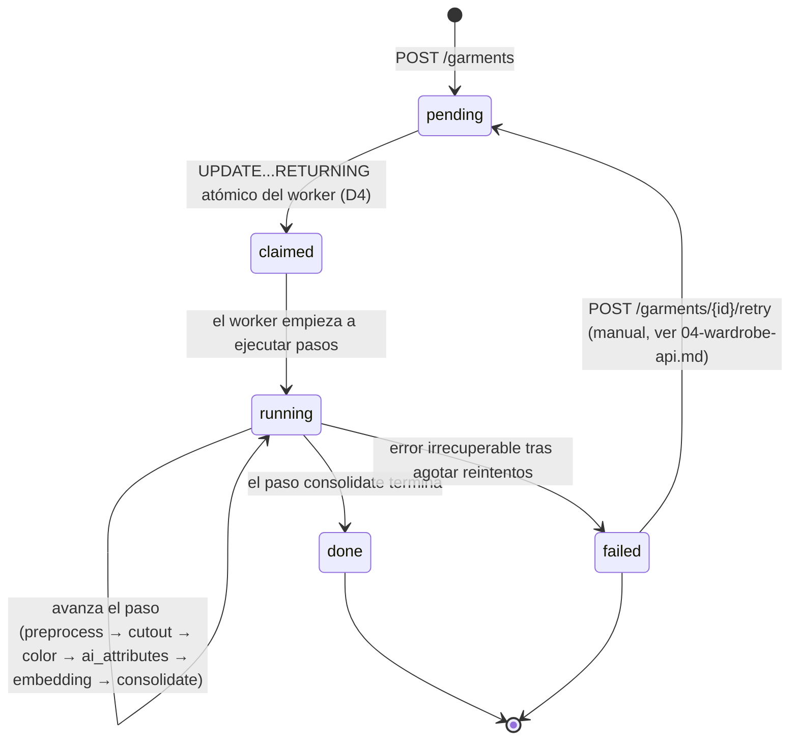

# 03 — Pipeline de ingesta de prendas

Estado: Draft

## Alcance

Contrato del endpoint de subida, máquina de estados del ciclo de vida de `job`, pasos del pipeline del worker (entradas/salidas/manejo de fallos), variantes e rutas de imagen, algoritmo de extracción de color, contrato de petición/respuesta del LLM, política de reintentos, embedding + aviso de duplicado, reglas de `needs_review`, reporte de progreso.

## Fuera de alcance

La UI de revisión/edición en sí (07-app-ui.md), el contrato de `PATCH /garments/{id}` y la regla de escritura de `ai_correction` (04-wardrobe-api.md, aunque el lado de *lectura* — el origen del few-shot — se especifica aquí).

## Dependencias

- Decisiones: D4 (reclamación atómica, transacciones cortas), D5 (tabla `job`), D9 (umbral de duplicados), D10 (confianza de color), D11 (modelo fijado + test de contrato), D19 (el pipeline es la única vía que activa `needs_review`; solo la acción "Revisión terminada" en 04-wardrobe-api.md lo desactiva).
- Modelo de datos: `garment`, `job`, `ai_correction` (02-data-model.md).
- Implementación de los pasos `cutout`, `ai_attributes` y `embedding`: 08-local-vision.md (BiRefNet, zero-shot SigLIP + kNN, LLM solo como respaldo opcional). Esta spec sigue siendo la fuente de verdad para el orden de los pasos, la máquina de estados del job y el algoritmo de color; 08-local-vision.md detalla cómo se implementan esos tres pasos concretos.

## Contrato del endpoint de subida

**ING-REQ-001.** `POST /garments` DEBE aceptar `multipart/form-data` con un único campo de fichero de imagen. DEBE crear una fila `garment` (`status=active`, todos los campos derivados de IA en null) y una fila `job` (`status=pending`, `garment_id` = la nueva prenda) en la misma transacción, y luego devolver `202 Accepted` con `{"garment_id": <uuid>, "job_id": <uuid>}`.

**ING-REQ-002.** El servidor DEBE rechazar (`400`) subidas que no sean una imagen decodificable, o cuyo lado largo exceda un tope duro (`PACHAPP_UPLOAD_MAX_PX × 2`, es decir, tolerar cierto margen del redimensionado en cliente pero rechazar tamaños absurdos).

**ING-REQ-003.** El servidor DEBE corregir la orientación EXIF y persistir el original corregido antes de devolver `202` (el original se guarda de forma síncrona en la petición; el procesado pesado se difiere al worker vía el job).

## Máquina de estados del ciclo de vida del job



**ING-REQ-004.** `job.step` DEBE actualizarse al comienzo de cada paso del pipeline (no solo al terminar), para que `GET /jobs/{id}` refleje el trabajo en curso, no solo el último paso terminado.

**ING-REQ-005.** Un fallo de paso que sea reintentable (ver Política de reintentos) NO DEBE transicionar `job.status` a `failed` en la primera ocurrencia — se reintenta dentro del mismo job. Solo agotar el presupuesto de reintentos transiciona a `failed`.

## Pasos del pipeline del worker

| Paso | Entrada | Salida | Manejo de fallos |
| --- | --- | --- | --- |
| `preprocess` | `img_original` (subida en crudo) | Imagen corregida por EXIF, orientación normalizada, en memoria | Imagen corrupta → `failed`, `error` fijado, sin reintento (ya validada en la subida) |
| `cutout` | Imagen preprocesada | `img_cutout` (PNG, fondo transparente, recortado a la bbox) + `img_thumb` (WebP, `PACHAPP_THUMB_PX`) escritos a disco; rutas guardadas en `garment` | BiRefNet vía `rembg` (08-local-vision.md) produce una máscara vacía o casi vacía (no detecta primer plano) → tratado como fallo blando: marcar `needs_review=true`, mantener `img_cutout` como mejor esfuerzo (o recaer en la imagen preprocesada completa), continuar el pipeline en lugar de fallar duro — un recorte malo sigue siendo revisable |
| `color` | Píxeles opacos de `img_cutout` | JSON `colors`, `is_neutral`, `color_confidence` | Menos de 1 clúster superviviente tras el descarte del umbral del 10% → `color_confidence` baja, se continúa (activa `needs_review` vía DAT-REQ-002, no un fallo de job) |
| `ai_attributes` | `img_cutout` + `colors` (nombres, usados solo si se llega al respaldo LLM) + embedding SigLIP de la imagen (calculado aquí y reutilizado por el paso `embedding`, ver 08-local-vision.md) | `category, subcategory, pattern, formality, style_tags, seasons, warmth, material` con `ai_confidence` por campo (`{value, confidence, source}`, DAT-REQ-021) — fuente primaria: zero-shot SigLIP + kNN (08-local-vision.md); el LLM con visión SOLO se invoca como respaldo condicional (ver "Contrato del LLM" más abajo) | Error de inferencia del clasificador local → reintentable una vez, luego se continúa con los campos IA en null y `needs_review=true` (igual que antes); si el respaldo LLM está activo y falla, el resultado de la mezcla zero-shot/kNN se mantiene igualmente (no se anula) |
| `embedding` | `img_cutout` (embedding SigLIP ya calculado en `ai_attributes`, ver arriba) | Vector float32 en `garment.embedding` (dimensión leída del modelo, `garment.embedding_dim`) + `garment.embedding_model`; `job.result.duplicate_candidate` si la similitud ≥ `setting.duplicate_warning_threshold` | Error de carga/inferencia del modelo → reintentable una vez, luego `failed` |
| `consolidate` | Todo lo anterior | `needs_review` finalizado (DAT-REQ-002), `job.status=done` | N/D — agregación pura, sin llamadas externas |

**ING-REQ-006.** Los pasos DEBEN ejecutarse en el orden fijo `preprocess → cutout → color → ai_attributes → embedding → consolidate`; `color` DEBE terminar antes que `ai_attributes` porque, cuando se llega al respaldo LLM (`PACHAPP_ML_LLM_FALLBACK=true`, 08-local-vision.md), su prompt incluye los nombres de color detectados como contexto. El paso `embedding` sigue siendo el que persiste `garment.embedding`/`embedding_model`/`embedding_dim`, aunque el vector en sí se calcule durante `ai_attributes` y se reutilice aquí (08-local-vision.md).

**ING-REQ-007.** El worker DEBE cargar los modelos ML (BiRefNet vía `rembg`, SigLIP vía `open_clip`; ver 08-local-vision.md) una sola vez al arrancar el proceso, no por job (coincide con "carga los modelos una vez" de c4.md).

## Variantes y rutas de imagen

**ING-REQ-008.** Las rutas guardadas en `garment` (`img_original`, `img_cutout`, `img_thumb`) DEBEN ser relativas a `PACHAPP_IMAGES_ROOT`, nunca absolutas — preserva la propiedad "mover a R2 más adelante sin migrar datos" señalada en la sección Aplazado de c4.md.

**ING-REQ-009.** Convención de disposición: `original/{garment_id}.jpg`, `cutout/{garment_id}.png`, `thumb/{garment_id}.webp`. *(valor por defecto, ajustable)*

## Algoritmo de extracción de color

**ING-REQ-010.** A partir de los píxeles opacos de `img_cutout` (alfa > umbral), convertir a CIELAB y ejecutar KMeans con `k=4`. *(valor por defecto, ajustable)*

**ING-REQ-011.** Descartar clústeres que representen `< 10%` de los píxeles opacos. Ordenar los clústeres restantes por proporción de píxeles descendente; el primero es el color dominante.

**ING-REQ-012.** Asignar a cada clúster superviviente el nombre más cercano de una paleta fija de ~20 colores por distancia ΔE en CIELAB (CIE76 o CIE2000 — decisión de implementación).

**ING-REQ-013.** Marcar `is_neutral = true` cuando el nombre del color dominante esté en `{negro, blanco, gris, beige, camel, marino, denim}`.

**ING-REQ-014.** `color_confidence` DEBE derivarse de la separación de clústeres de KMeans (p. ej. distancia ΔE inter-clúster normalizada, o inversa de la varianza intra-clúster relativa a la varianza inter-clúster) — un escalar único en `[0, 1]`. *(valor por defecto, ajustable — la fórmula exacta es un detalle de implementación; debe ser monótona: clústeres más ajustados y bien separados → mayor confianza.)*

## Contrato de petición/respuesta del LLM

El LLM con visión ya no es el clasificador primario (08-local-vision.md): `category, subcategory, pattern, formality, style_tags, seasons, warmth, material` se rellenan primero por zero-shot SigLIP + kNN. Todo este bloque (ING-REQ-015 a ING-REQ-020, ING-REQ-027) aplica **únicamente cuando `PACHAPP_ML_LLM_FALLBACK=true`** y el worker decide invocar el respaldo (`category` o `formality` siguen bajo el umbral tras la mezcla, ver 08-local-vision.md VIS-REQ-020).

**ING-REQ-015.** Cuando se invoca el respaldo LLM, la petición DEBE ser: la imagen `img_cutout` más los nombres de `colors` (no los píxeles en crudo — el color ya está determinado localmente) más hasta 5 ejemplos few-shot extraídos de las filas más recientes de `ai_correction` (agrupadas por campo, más recientes primero). *(N=5 es un valor por defecto, ajustable.)*

**ING-REQ-016.** Cuando se invoca el respaldo LLM, su respuesta DEBE validarse contra este modelo Pydantic v2 de enums cerrados (compartido con los enums de `shared`, DAT-REQ-001):

```python
class GarmentAttributesLLM(BaseModel):
    category: GarmentCategory
    subcategory: str
    pattern: GarmentPattern
    formality: int = Field(ge=1, le=5)
    style_tags: list[StyleTag]
    seasons: list[Season] = Field(min_length=1)
    warmth: int = Field(ge=1, le=5)
    material: str | None = None
    confidence: dict[str, float]  # claves: category, subcategory, pattern, formality,
                                    # style_tags, seasons, warmth, material (si está presente)
```

**ING-REQ-017.** Cuando se invoca el respaldo LLM, el prompt DEBE instruir explícitamente al modelo sobre la frontera `top` vs `mid_layer` vs `outerwear` (jersey/sudadera/cárdigan/sobrecamisa → `mid_layer`; abrigo/chaqueta de exterior → `outerwear`), ya que esta distinción es nueva en la iteración 1 (D17) y no resulta obvia solo por el nombre de la prenda. El mismo cuidado aplica al `TAXONOMY` del zero-shot (08-local-vision.md), que ya separa los prompts de `mid_layer` de los de `top`.

**ING-REQ-018.** Cuando el respaldo LLM está activo, `PACHAPP_LLM_MODEL_ID` DEBE ser un identificador de modelo fijado y exacto (no un alias "latest"), según D11.

**ING-REQ-019.** Si el respaldo LLM está activo en el entorno de test, un test de contrato (`backend/tests/contract/`) DEBE verificar que una respuesta de ejemplo grabada/mockeada del LLM para el modelo fijado sigue validando contra `GarmentAttributesLLM`, detectando derivas silenciosas de formato aguas arriba (D11). Este test no requiere red ni el flag activo en producción — corre contra una respuesta grabada.

**ING-REQ-027.** Cuando se invoca el respaldo LLM, su `confidence` DEBE contener una entrada por cada campo poblado por el modelo (todas las claves de `GarmentAttributesLLM` cuyo valor no sea `None`). Si al paso `consolidate` le falta la clave de confianza de un campo poblado, el worker DEBE tratar la confianza de ese campo como `0.0` para efectos de `ai_confidence` y de la regla de `needs_review` (dispara la revisión), en vez de omitir esa clave del `ai_confidence` guardado — ver DAT-REQ-017 en 02-data-model.md. La misma regla aplica, sin necesidad del LLM, a la salida del clasificador zero-shot/kNN (08-local-vision.md).

## Política de reintentos

**ING-REQ-020.** Cuando el respaldo LLM está activo y se invoca, ante un fallo de llamada (timeout, 5xx, error de red) o un `ValidationError` de Pydantic en la respuesta, el worker DEBE reintentar exactamente una vez. *(valor por defecto, ajustable — el borrador dice "un reintento".)*

**ING-REQ-021.** Si ese reintento del respaldo LLM también falla, el paso `ai_attributes` NO DEBE hacer fallar el job ni descartar el resultado de la mezcla zero-shot/kNN ya calculado: los campos que el LLM debía corregir se quedan con el valor y `source` que tenían tras la mezcla (`"zero_shot"`/`"knn"`/`"blend"`), `needs_review` sigue en `true` (ya lo estaba, por eso se invocó el respaldo). `job.error` registra el fallo subyacente para diagnóstico, pero `job.status` igualmente llega a `done`. Si en cambio falla el propio clasificador local (zero-shot/kNN, no el respaldo LLM) tras su reintento, el paso continúa con esos campos en `null`, `needs_review = true` en la consolidación — la prenda queda totalmente editable a mano desde la pantalla de Revisión.

**ING-REQ-022.** Los fallos en los pasos `preprocess`, `cutout` o `embedding` SÍ son reintentables una vez (errores transitorios de I/O/modelo); agotar ese reintento fija `job.status=failed` (estos pasos no tienen una alternativa segura de "continuar con nulls" como sí tiene `ai_attributes` — los fallos de cutout/embedding bloquean funcionalidad central como las miniaturas y la detección de duplicados).

## Embedding + aviso de duplicado

**ING-REQ-023.** Tras calcular el embedding SigLIP (08-local-vision.md), el worker DEBE comparar la similitud coseno contra los embeddings de todas las demás prendas `status=active` **con el mismo `embedding_model`** (08-local-vision.md, VIS-REQ-023). Si la similitud máxima ≥ `setting.duplicate_warning_threshold` (por defecto `0.92`, rango calibrado `0.90–0.95` según D9), el worker DEBE escribir `{"duplicate_candidate_garment_id": <uuid>, "similarity": <float>}` en `job.result`.

**ING-REQ-024.** La comprobación de duplicados es **solo un aviso** — NO DEBE bloquear la ingesta ni forzar `needs_review`; se muestra en la pantalla de Revisión como un aviso descartable que enlaza a la prenda similar (D9).

## Reglas de `needs_review`

Reformulado desde 02-data-model.md DAT-REQ-002 para el contexto del pipeline: en `consolidate`, `needs_review = true` si algún `ai_confidence[campo].confidence < setting.needs_review_threshold` (por defecto `0.7`, tratando como `0.0` cualquier campo poblado sin clave de confianza — ING-REQ-027/DAT-REQ-017) O `color_confidence < setting.color_review_threshold` (por defecto `0.7`) O la diferencia top-1/top-2 de algún atributo es `< PACHAPP_ML_MARGIN_THRESHOLD` (regla de margen de 08-local-vision.md, VIS-REQ-016; en la iteración 1 los atributos que disparan `needs_review` por confianza/margen del clasificador local son solo `category` y `pattern`, ver VIS-REQ-016) O el paso `ai_attributes` agotó su reintento del clasificador local (ING-REQ-021) O el paso `cutout` produjo una máscara vacía (fallo blando anterior). Un fallo del respaldo LLM opcional no añade un disparador nuevo: si se llegó a invocarlo, `needs_review` ya era `true` por alguna de las condiciones anteriores.

**(D19.)** El pipeline (este paso `consolidate`) es la **única** vía por la que `needs_review` pasa a `true`. Ninguna corrección de campo individual desde la pantalla de Revisión lo pone a `false` — solo la acción explícita "Revisión terminada" (`POST /garments/{id}/review/complete`, API-REQ-019 en 04-wardrobe-api.md) lo hace (DAT-REQ-018 en 02-data-model.md). Un reintento de ingesta (`POST /garments/{id}/retry`, API-REQ-011) que hace que `consolidate` se vuelva a ejecutar PUEDE volver a marcar `needs_review=true` con normalidad según esta misma regla, incluso si el usuario ya había completado una revisión anterior de esa prenda — no es un caso especial, es la regla de siempre aplicada de nuevo.

## Reporte de progreso

**ING-REQ-025.** `job.progress` (0–100) DEBE avanzar de forma monótona por paso: `preprocess=10, cutout=30, color=45, ai_attributes=75, embedding=90, consolidate=100`. *(valor por defecto, ajustable)*

**ING-REQ-026.** `GET /jobs/{id}` (definido en 04-wardrobe-api.md) DEBE devolver `{status, step, progress, error, result}` para el polling del cliente.

## Escenarios

**ING-SCN-001 — Camino feliz.**
Dada una foto bien iluminada de una sola prenda sobre fondo liso,
Cuando se sube vía `POST /garments`,
Entonces un `job` progresa `pending → claimed → running → done` a través de los seis pasos, la prenda termina con todos los campos IA poblados (por zero-shot/kNN, 08-local-vision.md), valores de `ai_confidence[campo].confidence` ≥ 0.7, `color_confidence` ≥ 0.7, y `needs_review = false`.

**ING-SCN-002 — El clasificador local falla dos veces.**
Dado que el clasificador zero-shot/kNN falla tanto en el intento inicial como en el reintento (p. ej. error de inferencia del modelo),
Cuando `ai_attributes` agota su reintento,
Entonces el job igualmente llega a `done`, `category`/`pattern`/etc. quedan `null`, `needs_review = true`, y la pantalla de Revisión muestra la prenda totalmente editable sin ningún prellenado de IA. (Si en cambio solo falla el respaldo LLM opcional tras la mezcla, el resultado de la mezcla se conserva — ver ING-REQ-021.)

**ING-SCN-003 — Solo confianza de color baja.**
Dado que KMeans produce clústeres mal separados en una prenda de patrón muy cargado,
Cuando `color_confidence` resulta `0.5` pero todos los valores de `ai_confidence` son `≥ 0.9`,
Entonces `needs_review = true` únicamente por la confianza de color (D10), y ningún otro campo queda marcado.

**ING-SCN-004 — Aviso de duplicado, no bloqueante.**
Dada una segunda foto de la misma chaqueta ya presente en el armario,
Cuando el paso de embedding encuentra una similitud coseno de `0.96` contra la prenda existente,
Entonces el job igualmente llega a `done`, la prenda se crea con normalidad, y `job.result.duplicate_candidate_garment_id` queda fijado para que la pantalla de Revisión lo muestre como un aviso descartable.

**ING-SCN-005 — Máscara vacía de rembg.**
Dada una foto donde la eliminación de fondo no produce primer plano utilizable (p. ej. la prenda se confunde con el fondo),
Cuando `cutout` detecta una máscara casi vacía,
Entonces el paso no falla duro; `needs_review = true`, y `img_cutout` de la prenda recae en la imagen preprocesada completa para que el pipeline pueda completarse y el usuario pueda reintentar la foto desde la pantalla de Revisión.

**ING-SCN-006 — Reclamación concurrente de workers.**
Dado que dos instancias del worker están corriendo simultáneamente (por configuración incorrecta) y hay dos jobs `pending`,
Cuando ambas hacen polling en el mismo instante,
Entonces la reclamación atómica `UPDATE...RETURNING` (DAT-REQ-009) garantiza que cada job es reclamado por exactamente un worker — sin procesamiento duplicado.

## Criterios de aceptación

- Con 30 prendas reales subidas, al menos 9 de cada 10 tienen `category` correcta sin ninguna corrección manual, y corregir el resto lleva menos de 10 segundos por prenda (objetivo de la Fase 2 del borrador "hecho cuando", reutilizado tal cual como el objetivo medible).
- Subir 10 prendas desde la app móvil hace que las 10 aparezcan recortadas (`img_cutout`/`img_thumb` presentes) en la cuadrícula del armario (objetivo de la Fase 1 del borrador, en la parte del pipeline de ingesta).
- Un fallo del test de contrato (ING-REQ-019) bloquea `make test`, detectando la deriva del modelo fijado antes de que llegue a la ingesta en producción.

## Preguntas abiertas

- Fórmula exacta de `color_confidence` (ING-REQ-014) — necesita ajuste empírico contra fotos reales de prendas antes de confiar en el umbral `0.7`.
- Variante exacta de ΔE (CIE76 vs CIE2000) y la propia lista de la paleta de ~20 nombres de color — no están enumeradas en el borrador; hay que redactarlas.
- Si un tercer reintento del respaldo LLM (más allá del actual 1, y solo relevante cuando `PACHAPP_ML_LLM_FALLBACK=true`) mejoraría de forma significativa el objetivo de precisión de 9/10, o si el ajuste del `TAXONOMY`/kNN (08-local-vision.md) es la palanca mejor — se difiere a la medición en tiempo de implementación.
- Si el comportamiento de recaída a la imagen completa de `img_cutout` (ING-SCN-005) debería en su lugar pedir al usuario que repita la foto de inmediato en lugar de continuar silenciosamente — una decisión de UX que pertenece a 07-app-ui.md.
