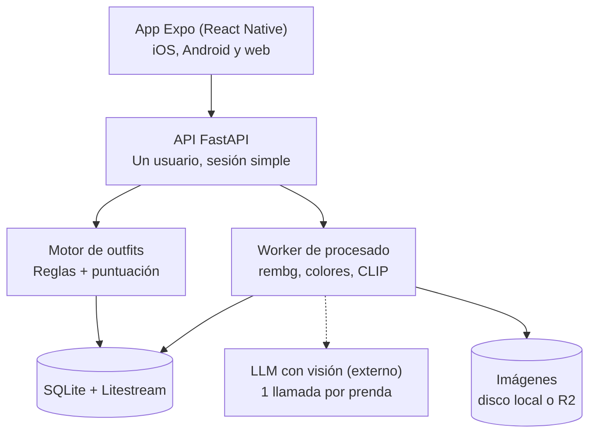

# Spec: Armario inteligente (recomendador de outfits)

27 de septiembre de 2026

## Resumen y decisiones clave

Una app personal en React Native (Expo), para móvil y web, con backend en Python que recorta y categoriza cada prenda con IA y genera outfits por color, estilo y novedad, por menos de 5 €/mes. El try-on virtual queda para la fase 2.

| Decisión | Elección | Por qué |
| --- | --- | --- |
| Usuarios | Solo tú | Sin multiusuario; autenticación mínima |
| Plataforma | App Expo (React Native) | Un solo código para iOS, Android y web, con cámara y gestos nativos |
| Backend | Python + FastAPI | Mejor ecosistema de visión (rembg, CLIP, Pillow) |
| Captura | Una prenda por foto | Recorte y clasificación mucho más fiables |
| Categorización | IA automática + revisión manual | Corregir es más rápido que etiquetar desde cero |
| Criterios de outfits | Color y estilo, no repetir, favoritos, historial | Los que elegiste |
| Fuera de la v1 | Clima, ocasión, try-on | Se añaden después sin rehacer el modelo de datos |
| Coste | Menos de 5 €/mes | Servidor pequeño + IA solo al dar de alta cada prenda; en iPhone, +99 $/año de Apple |

## Arquitectura y stack



La app solo habla con la API; el recorte, los colores y los embeddings se calculan en tu servidor, y solo el recorte de cada prenda viaja una vez al LLM de visión.

- **Frontend:** Expo (React Native + TypeScript, Expo Router) con `react-native-web` para la versión web. `expo-image-picker` para la cámara, `expo-image-manipulator` para reducir fotos antes de subirlas, `expo-image` para cuadrículas rápidas, `react-native-gesture-handler` + `reanimated` para deslizar outfits y TanStack Query para datos. Tipos y cliente generados desde el OpenAPI de FastAPI con `openapi-typescript`.
- **Backend:** FastAPI + SQLModel sobre SQLite, migraciones con Alembic. Para un solo usuario SQLite sobra y simplifica copias de seguridad.
- **Procesado:** Pillow (EXIF, resize, WebP), `rembg` para quitar el fondo, scikit-learn (KMeans) para colores, `open_clip` para embeddings. Cola simple: tabla `jobs` en SQLite + un proceso worker.
- **Visión:** un modelo barato con salida JSON (p. ej. Claude Haiku 4.5 o Gemini Flash), validada con Pydantic.
- **Despliegue:** Docker Compose. Opción A: VPS de 2 vCPU / 4 GB RAM (unos 4 €/mes). Opción B: un PC o mini-PC en casa (0 €). rembg y CLIP en CPU tardan unos segundos por foto, suficiente.
- **Acceso y copias:** Tailscale en el móvil para que la API no quede expuesta a internet, más login con token de sesión guardado con expo-secure-store. Litestream replica SQLite a Cloudflare R2 (capa gratuita).

## Modelo de datos

Cinco tablas cubren la v1; la tabla de fotos tuyas se crea ya aunque solo la use la fase 2.

**`garment` (prenda)**

| Campo | Tipo | Notas |
| --- | --- | --- |
| id, created\_at | uuid, datetime |  |
| img\_original, img\_cutout, img\_thumb | ruta | Original, PNG sin fondo, WebP de 400 px |
| category | enum | top, bottom, one\_piece (vestido/mono), outerwear, shoes, accessory |
| subcategory | texto | camiseta, camisa, vaquero, chino, zapatilla… |
| colors | JSON | Lista de {nombre, hex, lab, proporción}; la primera es la principal |
| is\_neutral | bool | Negro, blanco, gris, beige, camel, marino, denim |
| pattern | enum | liso, rayas, cuadros, estampado, textura |
| formality | int 1–5 | 1 deporte, 3 smart casual, 5 traje |
| style\_tags | lista | casual, clásico, street, minimal, deportivo… |
| seasons | lista | primavera, verano, otoño, invierno |
| warmth | int 1–5 | Útil cuando añadas el clima |
| material, brand, notes | texto | Opcionales |
| status | enum | activo, lavando, archivado |
| embedding | blob | Vector CLIP (512 floats) |
| ai\_confidence | JSON | Confianza por campo |
| needs\_review, user\_verified | bool | Control de la revisión |
| wear\_count, last\_worn\_at | int, date | Derivados del historial |

**`outfit`**: id, created\_at, source (generado / manual), score, score\_breakdown (JSON), is\_favorite, rating (−1, 0, +1), name.

**`outfit_item`**: outfit\_id, garment\_id, slot (top, bottom, one\_piece, outerwear, shoes, accessory).

**`wear_log`**: date, outfit\_id. Un registro por día que te pones algo; alimenta el historial y la regla de no repetir.

**`user_photo`** (fase 2): id, img, pose (frontal / lateral), created\_at.

## Pipeline de captura y categorización

Cada foto pasa por ocho pasos; todo es local salvo el paso 5, y el resultado llega a una pantalla de revisión donde confirmas o corriges.

1. **Captura.** Prenda sola, extendida sobre fondo liso o colgada en percha, con luz natural. La app muestra estos consejos la primera vez.
2. **Subida.** El cliente reduce la foto a 2048 px de lado largo antes de subirla. El servidor corrige la orientación EXIF y guarda el original.
3. **Recorte.** `rembg` genera un PNG con transparencia, se recorta a la caja de la prenda y se crea la miniatura WebP de 400 px.
4. **Colores.** Con los píxeles opacos, convertir a CIELAB y aplicar KMeans con k = 4. Descartar grupos con menos del 10 % de píxeles, ordenar por proporción y asignar a cada uno el nombre más cercano de una paleta de unos 20 colores (distancia ΔE). Marcar `is_neutral`.
5. **Atributos con IA.** Enviar el recorte y los colores detectados al LLM con visión. El prompt exige solo JSON con valores de enumeraciones cerradas (ver ejemplo). Validar con Pydantic; si falla, un reintento y después `needs_review`.
6. **Embedding.** Calcular el vector CLIP del recorte. Si la similitud con una prenda existente supera 0,95, avisar de posible duplicado.
7. **Guardar.** Cualquier campo con confianza < 0,7 activa `needs_review`.
8. **Revisión.** Pantalla con la foto y chips editables por campo; guardar pone `user_verified = true`. Tus correcciones se guardan para mejorar el prompt con ejemplos (few-shot).

Ejemplo de salida que debe devolver el LLM:

```json
{
  "category": "top",
  "subcategory": "camisa oxford",
  "pattern": "liso",
  "formality": 3,
  "style_tags": ["clásico", "casual"],
  "seasons": ["primavera", "otoño"],
  "warmth": 2,
  "material": "algodón",
  "confidence": {"category": 0.98, "formality": 0.8, "material": 0.6}
}
```

## Motor de outfits

El motor genera todas las combinaciones válidas, las puntúa y devuelve las 5 mejores y variadas; con 100–300 prendas eso son decenas de miles de combinaciones, que se evalúan por fuerza bruta con numpy en menos de un segundo, sin IA.

1. **Plantillas.** A: top + bottom + shoes. B: one\_piece + shoes. Ambas admiten outerwear y un accessory opcionales.
2. **Filtros duros.** Solo prendas `activo`. Diferencia de formalidad entre prendas ≤ 1. Al menos una temporada en común. Ningún outfit idéntico a uno llevado en los últimos 14 días. Si fijas una prenda, todas las combinaciones la incluyen.
3. **Puntuación.** Cada componente vale de 0 a 1 y se combina con pesos ajustables desde Ajustes (valores iniciales):

```latex
S = 0.35\,C_{color} + 0.25\,C_{estilo} + 0.25\,C_{novedad} + 0.15\,C_{preferencia}
```

4. **Color.** Los neutros combinan con todo. Máximo 2 colores no neutros por outfit. Entre dos no neutros se puntúa por tono: análogos (≤ 30°) alto, complementarios (150–210°) medio-alto, tríada medio, resto bajo. Bonus a tono sobre tono con contraste de luminosidad. Penalización fuerte a dos estampados llamativos juntos.
5. **Estilo.** Baja varianza de formalidad, `style_tags` compartidos y similitud media de embeddings CLIP entre las prendas.
6. **Novedad.** Por prenda, penalización e^(−días desde último uso / 7). Por pareja de prendas, penalización si se llevaron juntas recientemente. Bonus a prendas olvidadas (sin usar en 60 días).
7. **Preferencia.** Parejas de prendas presentes en favoritos o likes suman; en dislikes restan. Más adelante, sustituir por una regresión logística entrenada con tu feedback.
8. **Diversidad.** Elegir el top 5 con MMR: una misma prenda no aparece en más de 2 de las 5 propuestas.
9. **Explicación.** Una frase por outfit generada con plantillas a partir de `score_breakdown` ("Marino y camel: neutros clásicos; hace 3 semanas que no usas estos chinos"). Coste cero.
10. **Feedback.** Botones: no me gusta, siguiente, favorito, me lo pongo hoy. "Me lo pongo" crea un `wear_log` y actualiza `wear_count` y `last_worn_at`.

## Pantallas y UX

Ocho pantallas, con "Hoy" como pantalla de inicio y navegación inferior en móvil (Hoy, Armario, Añadir, Historial).

- **Hoy.** Una tarjeta de outfit con las prendas apiladas de arriba abajo (abrigo, top, bottom, calzado). Desliza a la izquierda para descartar y a la derecha para guardar en favoritos; botones para siguiente y me lo pongo. "Cambiar solo esta pieza" regenera un hueco manteniendo el resto.
- **Armario.** Cuadrícula de recortes sobre fondo neutro, filtros por categoría, color, temporada y estado, y una insignia en las prendas pendientes de revisar.
- **Añadir.** Abre la cámara; permite hacer varias fotos seguidas y muestra el progreso de cada una mientras el worker procesa.
- **Revisión.** Foto recortada y chips editables por atributo; los campos dudosos aparecen resaltados.
- **Detalle de prenda.** Atributos, veces usada, último uso, outfits en los que aparece, cambio de estado y botón "Crear outfit con esta prenda".
- **Favoritos.** Outfits guardados, reutilizables con un toque.
- **Historial.** Calendario con el outfit de cada día y estadísticas simples: prendas más usadas y prendas sin usar en 90 días.
- **Ajustes.** Pesos del motor, días de no repetir, exportar datos (JSON + imágenes en ZIP).

## Plan paso a paso

Seis fases en orden; cada una termina en algo usable y tiene su criterio de "hecho", así puedes parar en cualquier punto con una app que funciona.

1. **Fase 0: base del proyecto.**
   - Monorepo con `backend/` (FastAPI, SQLModel, Alembic, pytest) y `app/` (Expo + TypeScript + Expo Router).
   - Docker Compose con api, worker y volumen de datos; login con contraseña única y token de sesión.
   - Hecho cuando: abres la app en el móvil con Expo Go y en el navegador, inicias sesión y ves una pantalla vacía con datos de tu servidor.
2. **Fase 1: armario manual.**
   - Tablas `garment` y `jobs`; endpoints para subir, listar, editar y archivar prendas.
   - Subida desde la cámara, redimensionado, miniaturas y recorte con rembg en el worker.
   - Pantallas Armario, Añadir y Detalle con edición manual de todos los campos.
   - Hecho cuando: das de alta 10 prendas desde el móvil y aparecen recortadas en la cuadrícula.
3. **Fase 2: categorización automática.**
   - Extracción de colores con KMeans en CIELAB y paleta de nombres.
   - Llamada al LLM con visión, validación Pydantic, confianza por campo y `needs_review`.
   - Embeddings CLIP y aviso de duplicados; pantalla de Revisión.
   - Hecho cuando: con 30 prendas reales, al menos 9 de cada 10 tienen categoría correcta sin tocar nada, y corregir el resto lleva menos de 10 segundos por prenda.
4. **Fase 3: motor de outfits.**
   - Plantillas, filtros duros y las cuatro puntuaciones como funciones puras con tests unitarios.
   - Endpoint `POST /outfits/generate` con prenda fijada opcional; diversidad MMR y explicación por plantillas.
   - Pantalla Hoy.
   - Hecho cuando: 5 propuestas en menos de 1 segundo, y de 20 generadas te pondrías al menos la mitad.
5. **Fase 4: favoritos, historial y aprendizaje.**
   - Tablas `outfit`, `outfit_item`, `wear_log`; botones de feedback; pantallas Favoritos e Historial.
   - Regla de no repetir y penalización de novedad conectadas al historial; bonus y penalizaciones por likes.
   - Hecho cuando: tras marcar "me lo pongo", ese outfit no vuelve a salir en 14 días y sus prendas bajan en el ranking.
6. **Fase 5: pulido y despliegue.**
   - Despliegue en VPS o servidor en casa con Tailscale; Litestream a R2. La versión web se exporta con Expo y la sirve la propia API.
   - Builds con EAS: APK para Android, o TestFlight para iPhone (requiere cuenta de Apple Developer). Icono, splash, caché offline del armario, exportación de datos y pantalla Ajustes.
   - Hecho cuando: la app sobrevive a borrar el servidor y restaurar desde la copia, y abre el armario sin conexión.

## Fase 2: try-on virtual y extras

El try-on realista necesita GPU, así que conviene ejecutarlo bajo demanda en un servicio de pago por uso y solo cuando lo pidas, para no romper el presupuesto.

- **Fotos tuyas.** Cuerpo entero, frontal, fondo liso, ropa ajustada. Se guardan en `user_photo`; basta con 2 o 3.
- **Modelos.** Opciones abiertas de virtual try-on como IDM-VTON, CatVTON u OOTDiffusion, desplegadas en Replicate, fal o Modal; o un modelo generativo de edición de imagen vía API. Prueba 2 o 3 con tus fotos antes de elegir: la calidad varía mucho según la prenda.
- **Flujo.** Botón "Ver cómo me queda" en un outfit → job que aplica las prendas por capas (bottom, top, outerwear) → imagen guardada junto al outfit, para no pagar dos veces lo mismo.
- **Privacidad.** Tus fotos salen de tu servidor; elige un proveedor que no retenga ni entrene con los datos.
- **Otros extras.** Clima del día (usando `warmth` y `seasons`), ocasión (usando `formality`), detección de huecos en el armario ("te falta calzado neutro formal") y coste por uso si registras precios.

## Riesgos, costes y preguntas abiertas

El coste mensual queda entre 0 y unos 5 € en Android (en iPhone, súmale unos 8 €/mes por la cuenta de Apple Developer de 99 $/año), y el mayor riesgo es la calidad de las recomendaciones, no la técnica. Las cifras son aproximadas y conviene verificarlas al contratar.

| Concepto | Coste aproximado | Nota |
| --- | --- | --- |
| Servidor | 0 € en casa o unos 4 €/mes en VPS | 4 GB de RAM para rembg + CLIP |
| LLM con visión | Céntimos por prenda, pago único | Dar de alta 200 prendas debería costar menos de 1 € |
| Almacenamiento R2 | 0 € | Dentro de la capa gratuita para miles de fotos |
| Try-on (fase 2) | Pago por imagen | Solo bajo demanda y con caché |

- **Recomendaciones sosas o raras.** Mitigación: pesos ajustables, feedback desde el primer día y tests con tu armario real antes de refinar reglas.
- **Recorte malo en prendas claras sobre fondo claro.** Mitigación: fondo de contraste y opción de volver a hacer la foto desde Revisión.
- **Colores alterados por la luz.** Mitigación: luz natural y posibilidad de corregir el color principal a mano.
- **Abandono por pereza al dar de alta.** Mitigación: sesión de alta en serie con procesado en segundo plano.

Preguntas abiertas:

- [ ] ¿Servidor en casa o VPS? ¿Y tu móvil es iPhone o Android?
- [ ] ¿Qué proveedor de LLM con visión?
- [ ] ¿Capas en la v1 (camiseta + sobrecamisa) o solo un top por outfit?
- [ ] ¿Cuántas prendas tienes aproximadamente?
